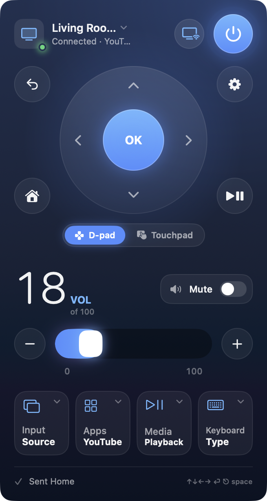
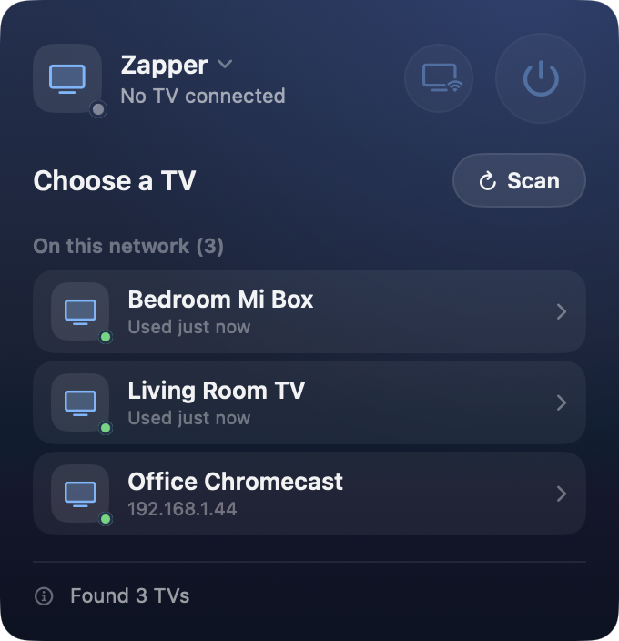
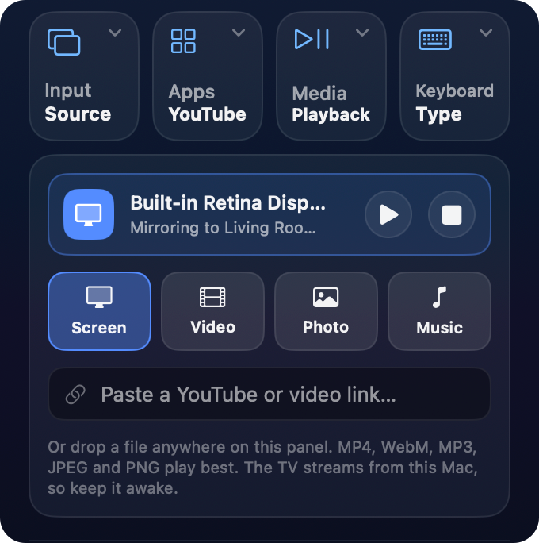

# Zapper

[](https://github.com/aminnazri/zapper/releases/latest)


A macOS menu bar remote for Google TV and Android TV. Point it at a Chromecast
with Google TV, a Xiaomi Mi Box or Mi TV, a Sony/TCL/Philips/Hisense Android TV,
an Nvidia Shield, and so on. It controls the device over your local network — no
phone, no vendor account, no cloud.

It also casts to the TV: video, photos and music from your Mac, a web link, or
your screen. Whole-screen sharing has a low-latency mode that mirrors in close to
real time instead of the two-second lag you get from normal casting.

There's a command-line tool alongside the app that exposes each layer
(discovery, pairing, key presses, casting) on its own, which is handy for
scripting or for figuring out why a particular TV is misbehaving.

Formerly called MiRemote.

<table align="center">
  <tr>
    <td rowspan="2" valign="top">
      
    </td>
    <td valign="top">
      
    </td>
  </tr>
  <tr>
    <td valign="bottom">
      
    </td>
  </tr>
</table>

<p align="center">The remote, picking a TV, and the cast drawer while mirroring the screen.</p>

## Install

### Download

**[Download Zapper-macOS.dmg](https://github.com/aminnazri/zapper/releases/latest/download/Zapper-macOS.dmg)**
(latest release). Release notes, older versions, and SHA-256 checksums are on
the [Releases](https://github.com/aminnazri/zapper/releases) page.

It's an Intel (x86_64) build and also runs on Apple Silicon through Rosetta 2.
You need macOS 13 Ventura or later.

1. Open the DMG and drag **Zapper** onto **Applications**.
2. Open Zapper from Applications. The first time, macOS blocks it because the
   app isn't notarized by Apple yet.
3. Go to **System Settings → Privacy & Security**, scroll down to the message
   about Zapper, click **Open Anyway**, and confirm. You only do this once.

If you prefer the terminal, this does the same as step 3:

```bash
xattr -dr com.apple.quarantine /Applications/Zapper.app
```

Zapper lives in the menu bar (look for the TV icon), not the Dock.

### Build from source

You need macOS 13 or later and a Swift toolchain (Xcode or the Command Line
Tools). There are no external dependencies.

```bash
git clone https://github.com/aminnazri/zapper.git
cd zapper
./Scripts/make-app.sh
open build/Zapper.app
```

`make-app.sh` compiles the app and the CLI, assembles the bundle, and signs it.
It builds for whatever architecture the Mac you run it on uses.

### Making a release

```bash
./Scripts/make-app.sh
codesign --force --deep --sign - build/Zapper.app   # ad-hoc, so it isn't tied to your local cert
./Scripts/make-dmg.sh                                # → build/Zapper-macOS.dmg
git tag -a v0.2.0 -m "Zapper 0.2.0" && git push origin v0.2.0
gh release create v0.2.0 build/Zapper-macOS.dmg --title "Zapper 0.2.0" --notes-file NOTES.md
```

Keep the asset named `Zapper-macOS.dmg`: the download link above points at
whichever release is latest and expects that name.

## Using the app

> **New here?** The [user guide](docs/USER-GUIDE.md) walks through every part
> of the app with screenshots: pairing, the remote, each drawer, casting,
> screen sharing, and the quality settings.

Open the menu and Zapper scans the network for TVs. Pick one and it connects.
The first time you connect to a given TV it asks you to pair: the TV shows a
six-character code, you type it into the app, and it's remembered after that.

The panel gives you:

- A D-pad with OK, Back, Home, and a settings button. Switch it to a touchpad
  for TVs running a browser with a mouse cursor.
- Volume and mute.
- A power button. See [Turning the TV on](#turning-the-tv-on) for how that works
  on a streaming box.
- A text field that types into whatever input is focused on the TV.
- A cast button for sending media or your screen (below).

While the panel is open your Mac keyboard drives the TV: arrow keys, Return,
Escape, Space for play/pause, `H` for home, `M` for mute, `-`/`=` for volume,
and `/` to open the on-screen keyboard.

The global hotkey **⌃⌥⌘T** turns the TV on from anywhere, even with the panel
closed.

## Casting

Open the cast drawer to send something to the TV:

- **A file** — drop a video, photo, or audio file onto the panel, or pick one.
- **A link** — paste a URL to a video or stream.
- **Your screen** — share a whole display, a single app, one window, or a
  browser tab.

If you share a browser tab that's showing a YouTube video, Zapper offers to open
it in the TV's own YouTube app instead. That plays at full quality with no lag
and keeps going while you do other things on the Mac.

### Real-time screen mirroring

Sharing a whole display uses a low-latency path built on Google's Cast Streaming
(the same mirroring protocol Chrome uses for "Cast screen"). It pushes each
frame to the TV as it's encoded, over UDP, which brings the delay down to a
fraction of a second rather than the ~2s that normal media casting buffers.

A few things to know:

- Quality and frame rate are set in the Screen tab. Quality is **540p**
  (2 Mbps), **720p** (4 Mbps, the default) or **1080p** (8 Mbps); frame rate is
  24–120 fps, 60 by default. 1080p floods many home Wi-Fi networks, and the
  packet loss looks worse than a clean 720p, so only use it on a strong
  connection. If the picture breaks up or stutters, lower quality first, then
  the frame rate.
- If the TV's mirroring receiver refuses the session, Zapper falls back to the
  regular casting path automatically, so you still get a picture.
- It's video only for now. Sound keeps playing on the Mac. If you need the
  audio on the TV, share an app, window, or tab instead, which goes through
  regular casting.
- Other sources (an app, a window, a tab) use the regular casting path for now.

Screen sharing needs the **Screen Recording** permission (macOS prompts you the
first time).

## Turning the TV on

A streaming box like a Mi Box is a *source*: it has no inputs of its own and
can't switch your TV's input. Zapper turns the TV on through **HDMI-CEC**. When
the box wakes, it sends a CEC "One Touch Play", which powers the TV on and
switches it to the box's input in one go.

You have to enable CEC on the TV first. It's usually off by default and every
brand names it differently: Samsung *Anynet+*, LG *SimpLink*, Sony *Bravia
Sync*, Xiaomi and TCL just call it *CEC*.

For TVs that support Wake-on-LAN, Zapper can also send a magic packet to wake the
device directly.

## Command-line tool

The `zapper` binary is built alongside the app (at `build/zapper`). It's useful
for scripting and for testing one layer at a time.

```
zapper discover                 find devices on the network (5s scan)
zapper probe <host>             TLS handshake against the pairing port
zapper pair <host>              pair (prompts for the on-screen code)
zapper key <host> <name>        send one key (up, down, ok, home, power, mute, …)
zapper applink <host> <uri>     launch an app or deep link on the device
zapper type <host> <text…>      type text into the focused field
zapper watch <host> [seconds]   print device state (foreground app, volume)
zapper wake <mac> [broadcast]   send a Wake-on-LAN magic packet
zapper mirror <host> [secs] [q] real-time screen mirror; q = 540p, 720p, 1080p
zapper mirror-probe <host>      negotiate a mirror session and print the answer
zapper identity [reset]         show or regenerate the client certificate
```

`probe` is a good first check: if the TLS handshake succeeds, certificates,
Keychain identity, and client auth are all working and the rest is just
messaging.

## How it works

Zapper speaks the Android TV Remote v2 protocol. It discovers devices over mDNS,
authenticates with a self-signed client certificate held in the Keychain, and
talks to the TV over TLS with mutual auth. Casting uses the Cast (Chromecast)
protocol: the control channel runs over TLS on port 8009, and media plays either
through the TV's Default Media Receiver (buffered, used for files and links) or
the Cast Streaming mirroring receiver (real-time, used for screen sharing).

The protocol details were recovered by decompiling the
`com.osfunapps.remoteformibox` Android app and cross-checked against the
[openscreen](https://github.com/webrtc/openscreen) Cast Streaming implementation.
Source comments cite the original class and field names where it matters.

## Project layout

```
Sources/ATVKit/              protocol core, no UI
  Identity.swift             RSA keypair → self-signed cert → Keychain identity
  Transport.swift            TLS with client auth
  Discovery.swift            mDNS browsing
  Wake.swift                 Wake-on-LAN magic packet
  CastChannel.swift          Cast control channel (port 8009)
  CastSession.swift          media playback via the Default Media Receiver
  ScreenStream.swift         screen capture → HLS (buffered cast path)
  CastStreaming/             real-time mirror: offer/answer, RTP, crypto, encoder
Sources/ZapperApp/           SwiftUI menu bar app
Sources/zapper/              command-line tool
Scripts/make-app.sh          builds and signs the .app without Xcode
Scripts/make-dmg.sh          packages the app into a drag-to-install DMG
docs/USER-GUIDE.md           how to use the app, with screenshots
Firmware/zapper-bridge/      optional ESP32 Bluetooth bridge firmware
```

## Troubleshooting

**The build fails with duplicate `SwiftBridging` module or missing
`Package.init` symbols.** Some Command Line Tools installs, usually ones
upgraded over an older install, leave stale module maps and interface files that
shadow the current ones. Two fixes, in order:

```bash
# 1. Duplicate module map that makes every `import Foundation` fail
sudo mv /Library/Developer/CommandLineTools/usr/include/swift/module.modulemap \
        /Library/Developer/CommandLineTools/usr/include/swift/module.modulemap.disabled

# 2. Stale private SwiftPM interfaces that break `swift build`
sudo find /Library/Developer/CommandLineTools/usr/lib/swift/pm \
     -name "*.private.swiftinterface" -exec mv {} {}.disabled \;
```

If SwiftPM still fails, reinstall the tools cleanly:

```bash
sudo rm -rf /Library/Developer/CommandLineTools && xcode-select --install
```

`make-app.sh` compiles with `swiftc` directly rather than through SwiftPM, so it
works even when the SwiftPM manifest library is broken.

**Casting a screen does nothing.** Check that Zapper has Screen Recording
permission in System Settings → Privacy & Security, then relaunch. macOS only
applies the grant to a fresh launch.

**The TV won't pair or respond.** Make sure the Mac and the TV are on the same
network and that CEC / the remote setting is enabled on the TV. `zapper probe
<host>` tells you whether the TLS layer is reaching the device.

## A note on the Mi TVs this was built against

The Xiaomi TVs tested here (platform `MiTV-MSSP3`) publish no IPv4 address and
share the mDNS hostname `Android.local.`, so discovery only yields IPv6
link-local addresses. Zapper recovers the hardware MAC from the EUI-64 interface
identifier for Wake-on-LAN. The device certificate's MAC is the Wi-Fi MAC plus
one (the Bluetooth MAC), and the certificate subject format varies between
firmware versions, so Zapper identifies devices by their mDNS name and never
parses the certificate.
