# Zapper user guide

This walks through everything in the Zapper panel, from finding your TV the
first time to mirroring your screen. If you haven't installed it yet, start
with [Install](../README.md#install) in the README.

**Contents**

1. [Before you start](#1-before-you-start)
2. [Find your TV](#2-find-your-tv)
3. [Pair it](#3-pair-it)
4. [The remote](#4-the-remote)
5. [Touchpad mode](#5-touchpad-mode)
6. [Volume](#6-volume)
7. [The tiles: Input, Apps, Media, Keyboard](#7-the-tiles)
8. [Casting files and links](#8-casting-files-and-links)
9. [Sharing your screen](#9-sharing-your-screen)
10. [Picture quality and frame rate](#10-picture-quality-and-frame-rate)
11. [While something is casting](#11-while-something-is-casting)
12. [Keyboard shortcuts](#12-keyboard-shortcuts)
13. [The TV menu](#13-the-tv-menu)
14. [When something goes wrong](#14-when-something-goes-wrong)

---

## 1. Before you start

- Your Mac and the TV need to be on the **same network**. A guest Wi-Fi or a
  separate 5 GHz/2.4 GHz network with client isolation will keep them apart.
- The TV has to be **on**, or at least in standby with network standby
  enabled. A TV that's fully off can't be found.
- The first time Zapper runs, macOS asks whether it may find devices on your
  **local network**. Say yes, otherwise it can't see the TV.

Zapper lives in the **menu bar**, not the Dock. Click the TV icon at the top of
the screen to open the panel. Click anywhere else to close it.

## 2. Find your TV

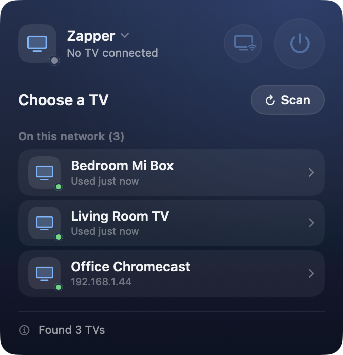

When you open the panel for the first time, Zapper scans the network and lists
what it finds under **On this network**.

Click a TV to connect to it.

TVs you've used before but that aren't reachable right now (another house,
switched off) are kept in a collapsed **Saved, not found here** list, so you
don't have to set them up again. Hover over one and click the trash icon to
forget it.

If your TV isn't listed:

- give it a few seconds; some TVs answer slowly,
- check the TV is on and on the same Wi-Fi as the Mac,
- open the TV menu (see [section 13](#13-the-tv-menu)) and choose
  **Find TVs on this network** to scan again.

 

## 3. Pair it

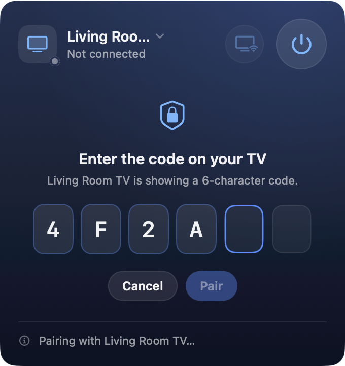

The first time you connect to a TV, it puts a **6-character code** on screen.
Type it into the boxes in Zapper and press **Return** or click **Pair**.

The code only uses the digits 0–9 and the letters A–F, so Zapper ignores
anything else you type. Upper or lower case doesn't matter.

You only pair once per TV. Zapper keeps its own certificate in your Keychain,
and the TV remembers it, so next time it connects straight away.

If the code disappears from the TV before you finish, click **Cancel** and
start again from the TV menu with **Pair with this TV…**.

 

## 4. The remote

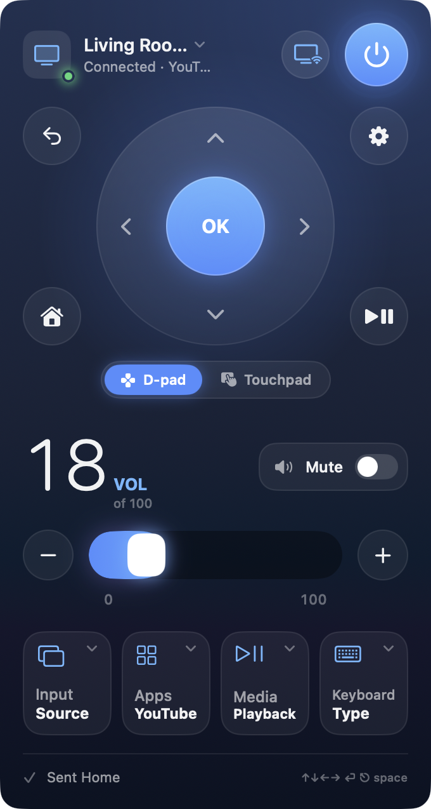

Once connected you get the remote. From top to bottom:

**Header.** The TV's name and what it's doing right now, for example
*Connected · YouTube*. The dot next to the TV icon is the connection light:
green is connected, blue and breathing is connecting, orange means the TV
can't be reached. On the right are the **cast** button (section 8) and the
**power** button.

**D-pad.** The ring is the arrow keys with **OK** in the middle. Around it:

| Button | Does |
| --- | --- |
| ↩︎ top left | Back |
| ⌂ bottom left | Home |
| ⚙︎ top right | Opens the TV's settings |
| ⏯ bottom right | Play / pause |

**Power.** Turns the TV on or off. If you're controlling a streaming box
(Mi Box, Chromecast, Shield), the box wakes the TV over HDMI-CEC. That only
works if CEC is switched on in the TV's settings; see
[Turning the TV on](../README.md#turning-the-tv-on).

**Status line.** The bottom of the panel shows what Zapper just did
(*Sent Home*, *Volume 18*) and a reminder that the Mac keyboard works while
the panel is open.

 

## 5. Touchpad mode

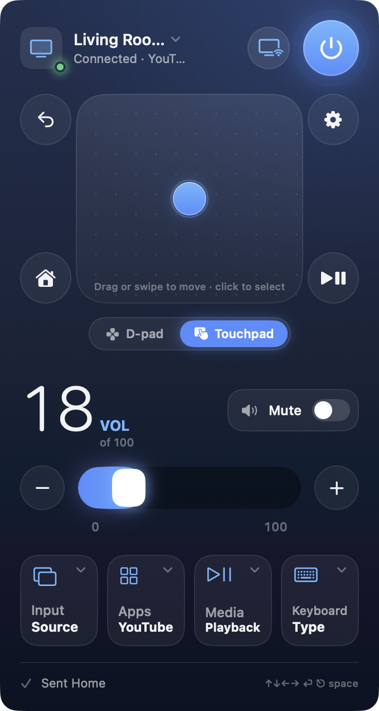

Some apps, mostly TV web browsers like TV Bro or Puffin, show a mouse cursor
instead of moving a highlight around. The arrow keys are painful there.

Switch the toggle under the D-pad to **Touchpad**. Now:

- **drag** or **swipe** inside the pad to move the cursor,
- **click** to select whatever's under it.

Zapper remembers which mode you used last.

 

## 6. Volume

The big number is the TV's current volume, read back from the TV so it stays
right even when someone uses the real remote.

- Drag the slider, or use **−** and **+**, to change it.
- The **Mute** switch mutes and unmutes.
- From the keyboard: **−** and **=** step the volume, **M** mutes.

If the TV sends its sound to a soundbar or receiver over HDMI ARC, the volume
keys control that instead, and the number may not move.

## 7. The tiles

The four tiles under the volume open a drawer underneath. Click a tile again,
or another one, to close it. The second line on each tile tells you what's
going on, for example **Apps · YouTube** when YouTube is in front.

### Input

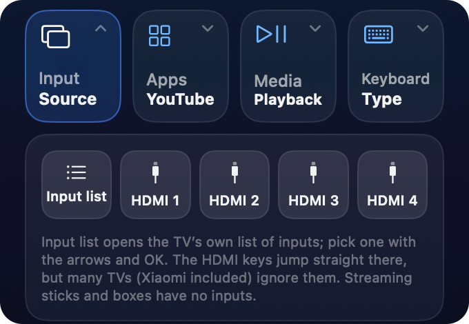

- **Input list** opens the TV's own source menu. Pick one with the arrows and
  OK.
- **HDMI 1–4** jump straight to that input. Plenty of TVs ignore these keys
  (Xiaomi does), in which case use Input list.

A streaming box has no inputs of its own, so these do nothing on a Mi Box or
Chromecast.

### Apps

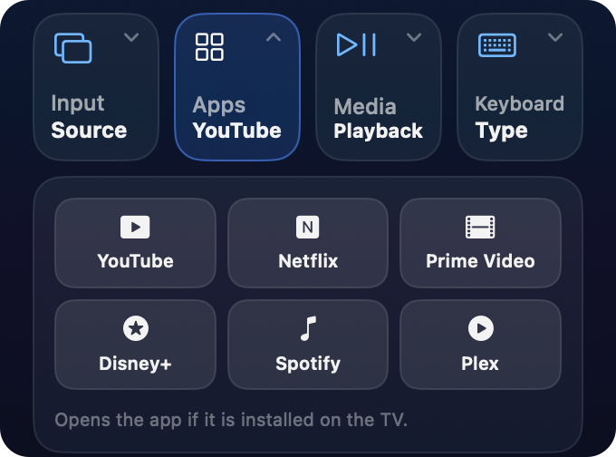

One click opens YouTube, Netflix, Prime Video, Disney+, Spotify or Plex on the
TV. The app has to be installed on the TV already.

### Media

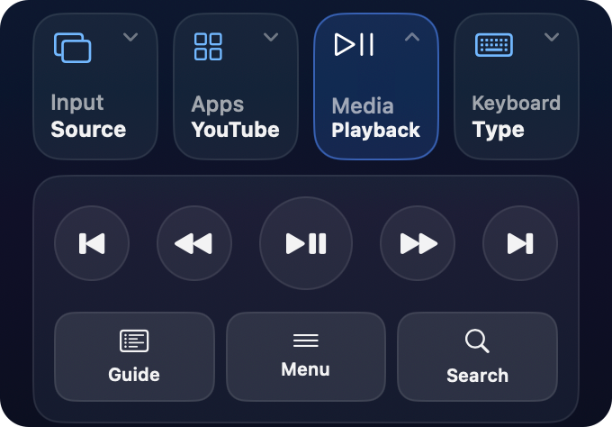

Previous, rewind, play/pause, fast-forward and next, plus **Guide**, **Menu**
and **Search**. Whether each one does something depends on the app that's
playing; Netflix ignores *Next*, for instance.

### Keyboard

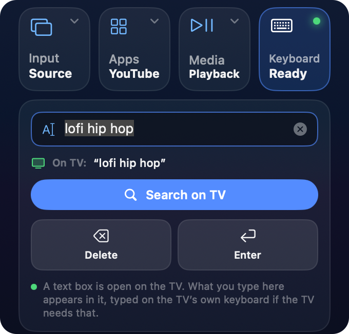

Typing with arrow keys on an on-screen keyboard is the worst part of any TV.
Use this instead.

1. Open a search box or text field on the TV.
2. The tile changes to **Keyboard · Ready** with a green dot, and the drawer
   shows what's currently in the TV's field (*On TV: "lofi hip hop"*).
3. Type in Zapper's field. Each letter appears on the TV as you type.
4. Press **Return** or **Enter** to submit, **Delete** to erase on the TV.

**Search on TV** searches YouTube on the TV for what you typed. If no text
field is open on the TV, pressing Return does the same.

Press **/** while the panel is open to jump straight to this drawer, and
**Esc** to leave the text field so the arrow keys go back to the TV.

## 8. Casting files and links

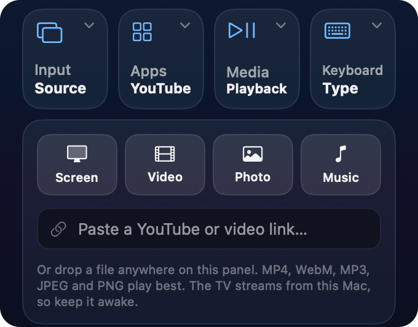

Click the **cast** button in the header (the screen with Wi-Fi waves) to open
the cast drawer.

**A file from your Mac.** Click **Video**, **Photo** or **Music** and pick a
file, or just drag a file from Finder anywhere onto the panel. The TV streams
it from your Mac, so keep the Mac awake and on the same network until it's
done. MP4, WebM, MP3, JPEG and PNG work best; formats the TV can't decode
won't play.

**A link.** Paste a link into the field and press Return. A YouTube link opens
in the TV's own YouTube app, at full quality. A direct video link (an `.mp4`
or a stream) plays in the TV's built-in player.

**Your screen.** Click **Screen**. That's the next section.

## 9. Sharing your screen

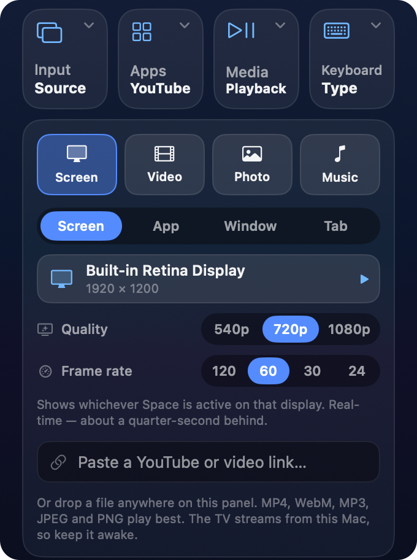

Click **Screen** in the cast drawer and choose what to share from the four
tabs:

| Tab | Shares | Delay |
| --- | --- | --- |
| **Screen** | A whole display, exactly as you see it | Real time, about ¼ s |
| **App** | Only that app's windows; everything else is black | About 2 s |
| **Window** | One window, even when other windows cover it | About 2 s |
| **Tab** | A browser window, cropped to the web page | About 2 s |

Click the ▶︎ next to an item to start.

**Screen** uses a real-time mirroring path, the same protocol Chrome uses for
*Cast screen*, so the TV follows your mouse with very little lag. It's good for
presentations, showing photos, or browsing together. It's **video only**: the
sound keeps playing on the Mac.

**App**, **Window** and **Tab** go through regular casting. They lag by a
couple of seconds but carry sound, so they're the better choice for watching
something.

If you share a browser tab that's playing a YouTube video, Zapper offers to
open that video in the TV's YouTube app instead. Take it: it's sharper, has no
delay, and keeps playing when you close the laptop.

The first time you share, macOS asks for **Screen Recording** permission. Turn
Zapper on in *System Settings → Privacy & Security → Screen Recording*, then
click **Relaunch** in the drawer. macOS only applies the permission after a
restart of the app.

For **Tab**, Zapper also asks for **Accessibility** permission. Without it the
whole browser window is shared, toolbar and all; with it, just the page.

 

## 10. Picture quality and frame rate

When the **Screen** tab is selected, two settings appear under the display
list. They apply the next time you start sharing, so stop and start again
after changing them.

**Quality** sets how sharp the picture is.

| Setting | Resolution | Data rate | Use it when |
| --- | --- | --- | --- |
| **540p** | 960 × 540 | 2 Mbps | The Wi-Fi is weak or busy, or the picture keeps breaking up |
| **720p** | 1280 × 720 | 4 Mbps | Most of the time. This is the default |
| **1080p** | 1920 × 1080 | 8 Mbps | The Mac is close to the router, or the TV is wired, and you need small text to be readable |

**Frame rate** sets how smooth motion is: **120**, **60** (default), **30** or
**24** frames per second. Higher is smoother and slightly snappier. Lower is
easier on the network.

If the picture stutters, freezes for a moment, or smears into blocks, the
network is dropping packets. Lower one setting at a time, quality first. 1080p
at 60 fps is about four times as much data as 540p at 30.

Your Mac's display is letterboxed into a 16:9 frame, so a MacBook's taller
screen gets thin black bars on the TV instead of being stretched.

## 11. While something is casting

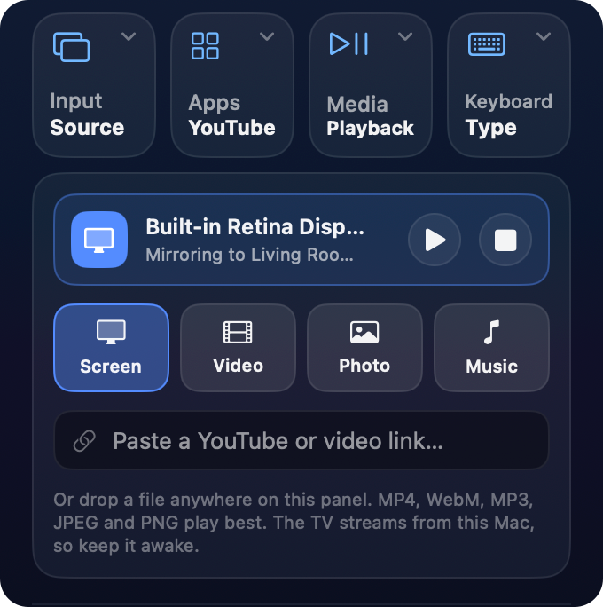

A card at the top of the cast drawer shows what's playing and on which TV,
with play/pause and **stop** buttons. For a video it also has a scrubber to
jump around.

When you close the cast drawer, a smaller version of the card stays above the
tiles, so you can stop the cast from anywhere in the panel.

Casting keeps going when you close the panel. It stops when you press stop,
when you start something else on the TV, or when you quit Zapper.

## 12. Keyboard shortcuts

These work while the panel is open and no text field is selected.

| Key | Does |
| --- | --- |
| ← ↑ → ↓ | Move (hold to repeat) |
| Return | OK |
| Esc or Delete | Back |
| Space | Play / pause |
| H | Home |
| M | Mute |
| − and = | Volume down / up |
| / or K | Open the Keyboard drawer |
| **⌃⌥⌘T** | Turn the TV on, from anywhere, even with the panel closed |

## 13. The TV menu

Click the TV's **name** in the header to get a menu with:

- every TV Zapper knows, to switch between them,
- **Find TVs on this network** to scan again,
- **Disconnect** from the current TV,
- **Pair with this TV…** if the pairing was lost (after a TV reset, say),
- **Test connection**, which checks that Zapper can reach the TV and that the
  TV still trusts it,
- **Wake with Wake-on-LAN** for TVs that support it,
- **Forget** to remove the TV from Zapper,
- **Open log**, useful when reporting a bug,
- **Quit Zapper**.

## 14. When something goes wrong

**The TV isn't found.** Make sure both are on the same network and the TV is
on. Some routers block devices from seeing each other (often called *AP
isolation* or *client isolation*); turn that off, or use the main network
instead of a guest one. Check Zapper is allowed under *System Settings →
Privacy & Security → Local Network*.

**It says Unreachable.** The TV went to sleep, changed IP address, or left the
network. Click **Retry**. If the TV is off, **Wake** tries to turn it on.

**It worked before but now wants to pair again.** The TV was reset or cleared
its paired devices. Click **Pair again** and enter the new code.

**The power button doesn't turn the TV on.** A TV that's fully off isn't on
the network. Enable *network standby* (sometimes *Quick start* or *Wake on
Wi-Fi*) in the TV's settings. For a streaming box, enable HDMI-CEC on the TV.

**Typing does nothing.** Some TVs, including some Xiaomi models, drop text
sent from a remote app. Use **Search on TV** instead, which opens YouTube
search results directly.

**Screen sharing shows nothing or a black picture.** Zapper doesn't have
Screen Recording permission, or got it without being restarted. Check
*System Settings → Privacy & Security → Screen Recording* and click
**Relaunch**.

**The mirrored picture lags or breaks up.** Lower the quality, then the frame
rate ([section 10](#10-picture-quality-and-frame-rate)). Moving the Mac
closer to the router, or using 5 GHz Wi-Fi, helps more than anything.

**Still stuck?** Open the TV menu → **Open log**, and attach the log to an
issue on the [issue tracker](https://github.com/aminnazri/zapper/issues).
